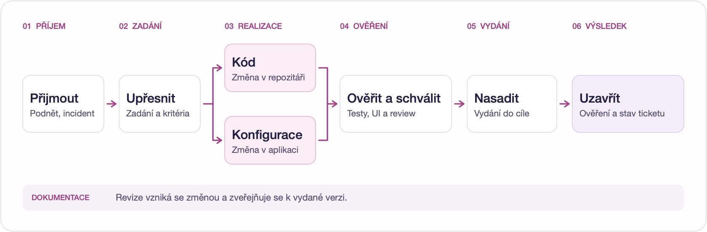

# NeoViia · Návrh agentního vývoje pro T-Mobile

Workflow od produktového podnětu nebo incidentu přes přípravu a ověření změny až po schválení, nasazení, aktualizaci dokumentace a uzavření ticketu.

[**Otevřít interaktivní mapu pipeline**](https://petrsovadina.github.io/neoviia-tmobile-pipeline/)

## Pipeline v kostce

## Projektové podklady

| Podklad | Obsah |
| --- | --- |
| [Kompletní klientské plátno](diagrams/T-Mobile-pipeline-pro-klienta.excalidraw) | Přehled šesti fází a 35 detailních kroků se vstupy, výstupy a odpovědnostmi. |
| [Architektura C4](diagrams/T-Mobile-SDLC-C4.excalidraw) | Kontext systému a hlavní kontejnery řešení. |
| [PRD](product/T-Mobile-SDLC-PRD.md) | Cíle, rozsah PoC, funkční a provozní požadavky, kritéria přijetí a otevřená rozhodnutí. |
| [Podklad pro první kolo](presentation/T-Mobile-navrh-prvni-kolo.pdf) | Dvoustránkové shrnutí k přeposlání. |
| [Editovatelný podklad pro první kolo](presentation/T-Mobile-navrh-prvni-kolo.excalidraw) | Shrnutí PoC a prezentační diagram v Excalidraw. |
| [Zdroj stránky](docs/index.html) | Samostatné HTML se zabudovanou mapou a rozbalovacími popisy 43 uzlů. |

První PoC má ověřit jeden ticket, jednu skutečnou větev změny a vydání do dohodnutého testovacího prostředí. Konkrétní integrace, oprávnění a podmínky produkčního nasazení se potvrdí s vlastníky služeb.

GitHub Pages publikuje složku `docs/` z větve `main`.
